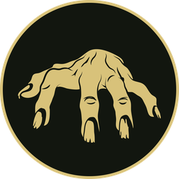
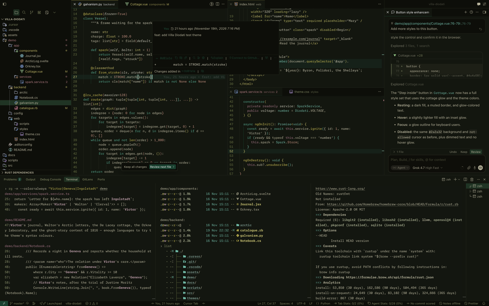
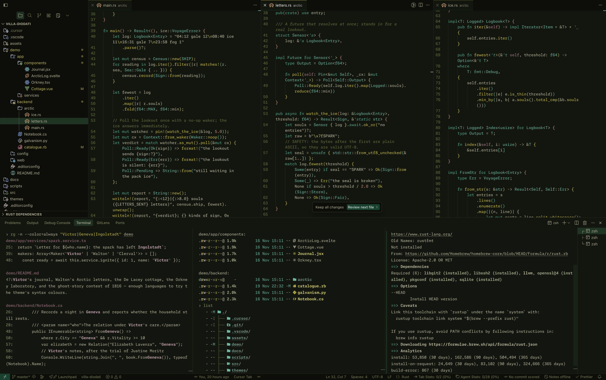
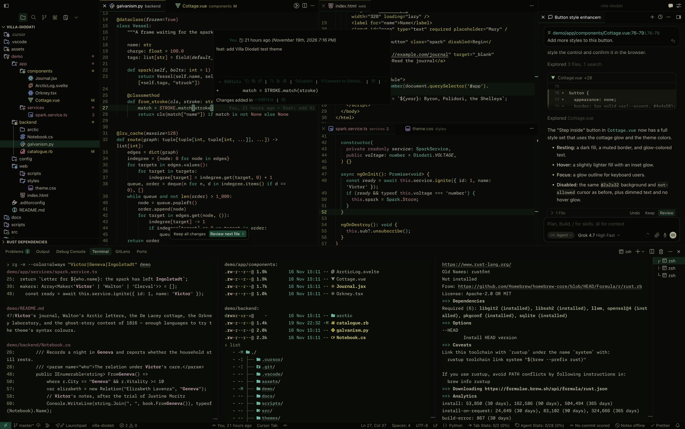
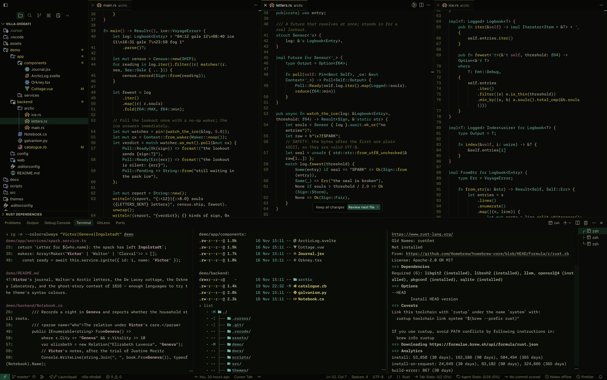

# Villa Diodati

<!-- Logo: assets/images/villa-diodati-logo.png. Uncomment when the icon is in the repo. -->
<!--
<p align="center"></p>
-->

Gothic dark themes for Visual Studio Code and Cursor, named after the villa on Lake Geneva where, in the wet summer of 1816, Mary Shelley first conceived *Frankenstein; or, The Modern Prometheus*. Near-black moss, a teal veil and acid gold silk, built for long sessions at night.

The palette is inspired by stills from Guillermo del Toro's *Frankenstein*. Villa Diodati is an independent theme and is not affiliated with or endorsed by the Shelley estate or any other *Frankenstein* adaptation.

The themes cover the current workbench and Cursor UI (chat and inline edits, command center, sticky scroll, bracket pairs, inlay hints, diffs and merge editor) and use semantic highlighting.

## The themes

Both share one syntax palette and differ only in their backgrounds:

- **Villa Diodati**: a mossy green-black background.
- **Villa Diodati Crypt Black**: the same colors on a near-black background with a faint moss tint, for a little more contrast.

Keywords are veil teal, functions acid gold, and constants a wine-rose. A lifted veil teal is reserved for the cursor, matching brackets and find matches.

## Villa Diodati

<!-- Screenshots: drop full-window shots in assets/screenshots/src/ as diodati.png and diodati-2.png, then run `npm run screenshots`. Uncomment when the files are in the repo. -->
<!--


-->

## Villa Diodati Crypt Black

<!-- Screenshots: drop full-window shots in assets/screenshots/src/ as crypt.png and crypt-2.png, then run `npm run screenshots`. Uncomment when the files are in the repo. -->
<!--


-->

# Installation

Search for `villa-diodati` in the Extensions view of VS Code or Cursor ([Open VSX](https://open-vsx.org/extension/rgsx/villa-diodati)), install it, then pick **Villa Diodati** or **Villa Diodati Crypt Black** under Preferences: Color Theme.

To install a `.vsix` file instead, run **Extensions: Install from VSIX...** from the Command Palette, or use `cursor --install-extension villa-diodati-0.1.0.vsix` (`code --install-extension ...` for VS Code).

## Build from source

All themes are generated from one source, so edit `src/` rather than `themes/*.json`:

- `src/palettes.js`: the palette of each theme (a theme can override the shared syntax colors with its own `syntax`)
- `src/ui-colors.js`: workbench colors
- `src/token-colors.js` and `src/semantic-token-colors.js`: syntax colors

```sh
npm run build        # regenerates themes/*.json (Node only, no dependencies)
npm run build:check  # fails if themes/ or the theme list in package.json is out of date
npm run package      # builds villa-diodati-<version>.vsix
npm run icons        # builds the 256 px icon from the 2048 px master logo (needs Pillow)
npm run screenshots  # scales the README screenshots (needs Pillow)
```

To try changes, open the folder in VS Code or Cursor and press F5. The `demo/` folder has sample files in many languages (TypeScript, JSX/TSX, Vue, Svelte, HTML, CSS, Python, Ruby, C#, Rust, JSON, YAML and Markdown) for checking the colors.

## Contrast

Measured against each theme's editor background (WCAG contrast ratio):

| Theme                      | Syntax colors  | Comments | Line numbers | White on buttons |
| -------------------------- | -------------- | -------- | ------------ | ---------------- |
| Villa Diodati              | 4.59:1 or more | 3.34:1   | 3.34:1       | 11.51:1          |
| Villa Diodati Crypt Black  | 4.92:1 or more | 3.59:1   | 3.59:1       | 11.51:1          |

In the terminal, the character under a block cursor stays visible, and bright blue matches the lab-green buttons so labels shown on it keep white text.

# Changelog

See [CHANGELOG.md](CHANGELOG.md).

# License

[MIT](LICENSE).

:zap:
